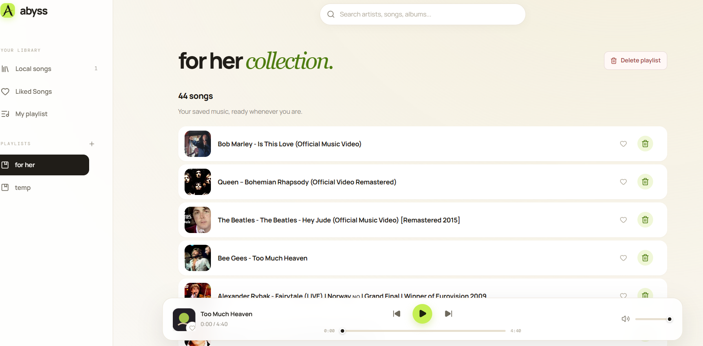
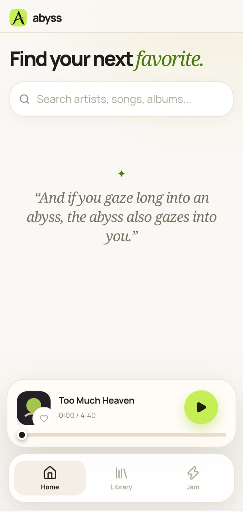

# abyss

**A small, private music space for listening together.**

abyss is a responsive music room built with React and Vite. Search YouTube, save songs to playlists, and start a shared jam room where friends can sync playback and chat in real time.





## Features

- Search YouTube videos with suggestions and playable results.
- Play local music and YouTube audio in the built-in player.
- Like songs and create personal playlists.
- Create or join a room with a short shareable code.
- Synchronize the current song, play/pause state, and playback position with everyone in a room.
- Chat with other people in the room.
- Responsive layout with installable PWA assets for mobile browsers.
- Express API and WebSocket server bundled with the production frontend.

## How it works

The browser talks to the Express server for YouTube search, suggestions, audio streaming, room state, and chat. WebSockets are served at `/ws`; HTTP endpoints are served under `/api`.

In production, the same Node process serves the built Vite app from `dist`, so a single web service is enough. Room membership and playback state are stored in memory. Restarting or redeploying the server clears active rooms; playlists and liked songs are stored locally in each browser.

## Run locally

### Requirements

- Node.js 20.19+ (or Node.js 22.12+)
- npm

Install dependencies:

```bash
npm install
```

Start the frontend and backend in separate terminals:

```bash
# Terminal 1 — Vite development server
npm run dev
```

```bash
# Terminal 2 — Express API and WebSocket server
npm run proxy
```

Open the Vite URL shown in the first terminal. During development, Vite proxies `/api` and `/ws` to `http://localhost:3001`.

You can also use the shortcut below if your shell supports background processes:

```bash
npm run dev:all
```

For a production-style local run:

```bash
npm run build
npm start
```

Then open `http://localhost:3001`.

## Deploy to Render

Create a **Web Service** connected to this repository with the following settings:

| Setting | Value |
| --- | --- |
| Environment | Node |
| Build command | `npm run build` |
| Start command | `npm start` |
| Node version | `20.19.0` or newer |

Render provides the `PORT` environment variable automatically. The server uses it and falls back to port `3001` for local development.

For a single-service deployment, leave `VITE_JAM_API` unset. The frontend will use the same origin for `/api` and `/ws`, which keeps search, streaming, room sync, and chat working without extra CORS configuration.

After deployment, check the service health endpoint:

```text
https://<your-render-service>.onrender.com/api/health
```

It should return JSON with `ok: true`.

### Optional environment variables

| Variable | When to use it |
| --- | --- |
| `YT_COOKIE` | Optional YouTube cookie value for an authenticated Innertube session. Add it as a secret environment variable in Render; never commit it to the repository. |
| `VITE_JAM_API` | Only needed when the frontend is hosted separately from the backend. Set it to the backend’s full URL, without a trailing slash. |
| `PORT` | Set automatically by Render. Do not hard-code it in deployment configuration. |

If the frontend and backend are split across services, the backend must allow the frontend origin through CORS and the frontend’s WebSocket URL must be reachable over `wss://`.


## Project structure

```text
src/                  React application, UI, styles, and app data
server/proxy.mjs      Express API, YouTube proxy, rooms, and WebSockets
public/               PWA assets, branding, icons, and local music
scripts/              Playlist utility scripts
test/                 Frontend utility and server tests
docs/screenshots/     README screenshots
```

## Notes

- YouTube playback depends on upstream availability and may occasionally require `YT_COOKIE`.
- The app does not persist room state on the server. Use a shared database or external state store if rooms need to survive restarts or scale across multiple instances.
- The `public/songs` directory contains the local starter track used by the app.

## License

No license has been specified yet.
